# Mô hình dữ liệu

Có 54 bảng, toàn bộ là dữ liệu mẫu. Model trong `backend/app/models/` là nguồn của schema, tạo qua migration `backend/migrations/`. Mọi khóa ngoại dùng `ON DELETE RESTRICT`, `PRAGMA foreign_keys=ON` bật cho mọi kết nối SQLite. Mọi bảng có `is_mock`, trừ `audit_logs` và `notifications`. Khóa chính kiểu chuỗi, giữ id của fixture; bản ghi tạo khi chạy dùng UUID; `audit_logs` và `notifications` dùng số nguyên tự tăng.

Điểm, GPA và ngưỡng dùng `Numeric` tỷ lệ cố định, đọc ra `Decimal`. SQLite lưu chúng dưới dạng số thực, nên cấm `SUM`, `AVG` trên cột điểm trong SQL.

## ERD

Sơ đồ chỉ gồm các quan hệ chính.

```mermaid
erDiagram
    roles ||--o{ users : role_id
    users ||--o| students : user_id
    programs ||--o{ program_versions : program_id
    program_versions ||--o{ students : program_version_id
    program_versions ||--o{ curriculum_requirements : program_version_id
    program_versions ||--o{ elective_groups : program_version_id
    elective_groups ||--o{ curriculum_requirements : elective_group_id
    courses ||--o{ curriculum_requirements : course_id
    course_groups ||--o{ courses : course_group_id
    courses ||--o{ course_prerequisites : course_id
    courses ||--o{ course_equivalencies : course_a_id
    course_equivalencies ||--o{ course_equivalency_scopes : equivalency_id
    courses ||--o{ course_offerings : course_id
    semesters ||--o{ course_offerings : semester_id
    students ||--o{ enrollments : student_id
    courses ||--o{ enrollments : course_id
    semesters ||--o{ enrollments : semester_id
    enrollments ||--o| grade_attempts : enrollment_id
    grade_scales ||--o{ grade_scale_levels : grade_scale_id
    grade_scales ||--o{ academic_rules : grade_scale_id
    users ||--o{ advisor_assignments : advisor_user_id
    students ||--o{ advisor_assignments : student_id
    careers ||--o{ career_versions : career_id
    career_versions ||--o{ career_nodes : career_version_id
    career_nodes ||--o{ career_requirements : career_node_id
    courses ||--o{ career_requirements : course_id
    skills ||--o{ career_requirements : skill_id
    courses ||--o{ course_skill_mappings : course_id
    skills ||--o{ course_skill_mappings : skill_id
    students ||--o{ student_career_goals : student_id
    careers ||--o{ student_career_goals : career_id
    students ||--o{ skill_evidences : student_id
    skills ||--o{ skill_evidences : skill_id
    students ||--o{ learning_roadmaps : student_id
    careers ||--o{ learning_roadmaps : career_id
    learning_roadmaps ||--o{ roadmap_versions : roadmap_id
    roadmap_versions ||--o{ roadmap_items : roadmap_version_id
    programs ||--o{ learning_resources : scope_program_id
    students ||--o{ improvement_plans : student_id
    improvement_plans ||--o{ improvement_plan_items : plan_id
    students ||--o{ support_requests : student_id
    support_categories ||--o{ support_requests : category_id
    support_categories ||--o{ support_staff_categories : category_id
    users ||--o{ support_staff_categories : user_id
    support_requests ||--o{ support_messages : request_id
    support_messages ||--o{ support_attachments : message_id
    support_requests ||--o{ support_status_events : request_id
    skill_evidences ||--o{ skill_evidence_attachments : evidence_id
    users ||--o{ notifications : user_id
    users ||--o{ audit_logs : actor_id
```

## Bảng

### Shared (16)

| Bảng | Mô tả |
|------|-------|
| `roles` | Bốn vai trò: student, advisor, support_staff, admin. |
| `users` | Tài khoản, mật khẩu băm. Có `is_active`, `last_login_at`; `failed_login_count`, `failed_login_window_started_at`, `locked_until` để khóa tài khoản; `session_version` để cookie cũ mất hiệu lực sau khi đăng xuất. |
| `students` | Hồ sơ sinh viên: mã, khóa, phiên bản CTĐT, kỳ nhập học, `contact_email`, `contact_phone`. |
| `programs` | Chương trình đào tạo mẫu. |
| `program_versions` | Phiên bản CTĐT theo khóa (`version`, `effective_cohort`). |
| `semesters` | Học kỳ theo thứ tự, tối đa một kỳ hiện tại. |
| `course_groups` | Nhóm môn cho phân tích mạnh/yếu. |
| `courses` | Học phần. Khóa chính là `id`; `code` có thể null. |
| `course_prerequisites` | Tiên quyết, là đồ thị có hướng không chu trình. |
| `course_equivalencies` | Cặp tương đương có người duyệt. |
| `course_equivalency_scopes` | Phiên bản CTĐT mà cặp tương đương có hiệu lực. |
| `elective_groups` | Nhóm tự chọn, có tín chỉ tối thiểu. |
| `curriculum_requirements` | Học phần thuộc CTĐT, bắt buộc hoặc tự chọn. |
| `course_offerings` | Lịch mở lớp. Không có bản ghi nghĩa là không có dữ liệu. |
| `enrollments` | Mỗi lần đăng ký học, giữ trạng thái `in_progress`, `final`, `withdrawn`, `exempt`. |
| `advisor_assignments` | Sinh viên do cố vấn phụ trách. |

### M11 (4)

| Bảng | Mô tả |
|------|-------|
| `grade_scales` | Thang điểm theo khóa (`version`, `effective_cohort`). demo-k68 có thêm bản 2 theo bảng của quản lý dự án (D-308). |
| `grade_scale_levels` | Các mức của thang: chữ, điểm tối thiểu, hệ 4, đạt. |
| `academic_rules` | Quy chế theo khóa: `retake_policy`, ngưỡng cảnh báo, ngưỡng nhóm môn. |
| `grade_attempts` | Kết quả một lần học. Là nguồn sự thật của trạng thái đạt. Chỉ đăng ký `final`, `exempt` mới có attempt. `recorded_at` (cho phép null, migration 0013): thời điểm nhập điểm. `attendance_score`, `midterm_score`, `final_score` (cho phép null, migration 0014): điểm thành phần 10/40/50; có thì `score_10` = tổng có trọng số làm tròn 1 chữ số. |

### M12 (22)

| Bảng | Mô tả |
|------|-------|
| `careers` | Danh mục nghề, có `field` (lĩnh vực) và `name_key` (tên đã chuẩn hóa, UNIQUE). |
| `career_versions` | Phiên bản nghề `draft` hoặc `published`; bản published không sửa được. Mỗi nghề tối đa 1 draft, service kiểm tra. |
| `career_nodes` | Nhóm năng lực của một phiên bản nghề, có `short_desc`. |
| `career_requirements` | Yêu cầu học phần, kỹ năng hoặc dự án, có nguồn và người duyệt. |
| `skills` | Kỹ năng và dự án, có `name_key` (UNIQUE), `short_desc`. |
| `course_skill_mappings` | Ánh xạ môn và kỹ năng, chỉ để hiển thị và gợi ý. |
| `student_career_goals` | Nghề chính của sinh viên, giữ lịch sử bằng `ended_at`. |
| `skill_evidences` | Minh chứng kỹ năng, có luồng nộp và duyệt; đã có dữ liệu mẫu. |
| `learning_roadmaps` | Lộ trình của sinh viên theo nghề. |
| `roadmap_versions` | Phiên bản lộ trình `active`, `proposal`, `archived`. |
| `roadmap_items` | Môn hoặc kỹ năng theo kỳ, độ chắc chắn, phụ thuộc kết quả, ngoài CTĐT. |
| `learning_resources` | Quy định, FAQ, học liệu, kỹ năng, có nguồn và phạm vi. **Chưa dùng: M12-11 hoãn.** |
| `risk_action_templates` | Mẫu việc cho mỗi quy tắc cảnh báo, đã có dữ liệu mẫu. |
| `improvement_plans` | Kế hoạch cải thiện. |
| `improvement_plan_items` | Việc trong kế hoạch. |
| `support_categories` | Nhóm vấn đề hỗ trợ. |
| `support_staff_categories` | Nhóm vấn đề được gán cho nhân sự hỗ trợ. |
| `support_requests` | Ticket, mã dạng `HT-YYYYMM-0001`. |
| `support_messages` | Phản hồi trong ticket. |
| `support_status_events` | Lịch sử đổi trạng thái của ticket. |
| `skill_evidence_attachments` | Tệp đính kèm của minh chứng. |
| `support_attachments` | Tệp đính kèm, tên lưu duy nhất, có `sha256`. |

### System (2)

| Bảng | Mô tả |
|------|-------|
| `notifications` | Thông báo trong hệ thống. |
| `audit_logs` | Nhật ký thay đổi, chỉ thêm, không sửa. Đã dùng cho `flask grades add`. |

### Lịch học và LMS (CR-11, D-309, migration 0015)

| Bảng | Cột chính | Ghi chú |
|------|-----------|---------|
| `course_schedules` | `course_id`, `semester_id`, `weekday` (1 = Thứ 2 … 7), `first_session_date`, `total_sessions` | Unique (môn, kỳ). 1 buổi/tuần; tuần k của môn = ngày buổi k tới ngày trước buổi k+1 |
| `lms_snapshots` | `student_id`, `course_id`, `semester_id`, `week_no`, `as_of`, `source` (`demo_form`, `lms`), `sent_at`, `received_at`, `sent_by` | Unique (sinh viên, môn, kỳ, tuần của môn); gửi lại thì ghi đè. Bản chụp tích lũy tới `as_of` |
| `lms_attendance` | `snapshot_id`, `session_no`, `session_date`, `status` (`present`, `absent`, `excused`) | Unique (bản chụp, buổi) |
| `lms_assignments` | `snapshot_id`, `code`, `name`, `due_date`, `submitted_on`, `score_10`, `weight` | Điểm 0–10 hoặc null; có điểm thì phải có ngày nộp (CHECK) |
| `lms_assessments` | `snapshot_id`, `kind` (`quiz`, `midterm`), `code`, `name`, `taken_on`, `score_10`, `weight` | |

Không lưu số tổng (vắng, đã nộp, điểm trung bình): `lms_service.summarize()` tính lại mỗi lần đọc. Dự kiến cho CR-13 (chưa tạo): trọng số điểm theo môn (0,1 / 0,4 / 0,5), cấu hình cảnh báo vắng (Q88).

### Báo cáo tuần (CR-12, D-312, migration 0016)

| Bảng | Cột chính | Ghi chú |
|------|-----------|---------|
| `weekly_reports` | `student_id`, `course_id`, `semester_id`, `week_no`, `postpone_count` (0, 1), `postponed_at`, `submitted_at` (giờ thật), `submitted_on` (ngày nghiệp vụ), `attendance`, `self_study`, `understanding` (1–5), `unclear_note` (≤ 300), `assignment`, `confidence` (1–5), `obstacle`, `next_plan`, `attendance_mismatch`, `assignment_mismatch` | Unique (sinh viên, môn, kỳ, tuần của môn). Dòng tạo khi "Làm sau" hoặc nộp. CHECK: chưa nộp thì chưa có câu trả lời; đã nộp thì đủ 7 câu bắt buộc. Cờ lệch NULL = chưa đối chiếu |

Trạng thái (chưa mở, đang mở, đã nộp, không nộp) **không lưu**: `weekly_report_rules.report_status()` tính từ `clock.today()`, lịch học và `submitted_at`.

### Khung năng lực, bài kiểm tra, chứng chỉ (CR-04)

| Bảng | Cột chính | Ghi chú |
|------|-----------|---------|
| `career_modules` | `career_version_id`, `program_id`, `order`, `title`, `objectives`, `extra_knowledge`, `practice`, `skill_id` | Mỗi mô-đun ứng với đúng 1 kỹ năng (`skill_id` unique) |
| `career_module_courses` | `module_id`, `course_id`, `order`, `takeaways` | BB/TC, học kỳ lấy từ `curriculum_requirements` |
| `career_milestones`, `career_milestone_modules` | `name`, `projects`; `milestone_id`, `module_id` | Thực tập sinh, Fresher, Junior |
| `career_suggested_electives` | `career_version_id`, `program_id`, `course_id`, `order` | Bộ tự chọn đề xuất |
| `quiz_questions` | `module_id`, `kind`, `prompt`, `code_snippet`, `explanation`, `status`, `verification` (`run`, `theory`, `review`), `reviewed_by`, `reviewed_on`, `approved_by`, `approved_at` | Chỉ câu `approved` được dùng. Câu `review` phải có người rà và ngày, câu khác để trống (CHECK, migration 0012) |
| `quiz_options` | `question_id`, `order`, `text`, `is_correct` | |
| `quiz_attempts` | `student_id`, `module_id`, `attempt_no`, `status`, `started_at`, `deadline_at`, `submitted_at`, `correct_count`, `total`, `met_threshold` | Index unique một phần: tối đa 1 lượt `in_progress` mỗi sinh viên, mỗi mô-đun |
| `quiz_attempt_questions` | `attempt_id`, `question_id`, `order`, `option_order`, `selected_option_ids`, `is_correct` | |
| `certificates` | `code`, `student_id`, `module_id`, `attempt_id`, `student_name`, `module_title`, `correct_count`, `total`, `issued_at`, `revoked_at` | `code` unique, 1 chứng chỉ mỗi sinh viên, mỗi mô-đun |

`skill_evidences` có thêm `source` (`submission`, `quiz`).

## Ràng buộc yêu cầu

| Ràng buộc | Bảng | Cách làm |
|-----------|------|----------|
| `code` nullable, UNIQUE khi khác null | `courses` | Partial unique `uq_courses_code_not_null` |
| `status` thuộc {in_progress, final, withdrawn, exempt} | `enrollments` | CHECK `status_valid` |
| UNIQUE(id, student_id, course_id, semester_id) | `enrollments` | UNIQUE, đích của khóa ngoại phức hợp |
| Tối đa 1 attempt mỗi đăng ký | `grade_attempts` | UNIQUE `enrollment_id` |
| Attempt khớp đăng ký | `grade_attempts` | Khóa ngoại phức hợp `fk_grade_attempts_enrollment_consistent` |
| Điểm hệ 10 trong [0, 10] | `grade_attempts` | CHECK `score_range` |
| Không tạo attempt khi `in_progress`, `withdrawn` | `grade_attempts` | Trigger `trg_grade_attempts_status_on_insert`, `_on_update` |
| Attempt miễn có điểm null, `passed = 1` | `grade_attempts` | Trigger `trg_grade_attempts_exempt_on_insert`, `_on_update` |
| Tối đa 1 nghề chính đang hiệu lực | `student_career_goals` | Partial unique `uq_student_career_goals_one_primary` |
| `status` thuộc {draft, published} | `career_versions` | CHECK `status_valid` |
| Bản published không sửa được | `career_versions` | Trigger `trg_career_versions_no_update_published`, `_no_delete_published`, `_no_insert_published` |
| Nội dung bản published không sửa được | `career_nodes`, `career_requirements` | Trigger `no_insert`, `no_update`, `no_delete` trên mỗi bảng |
| Tên đã chuẩn hóa không trùng | `careers`, `skills` | Unique index `uq_careers_name_key`, `uq_skills_name_key` |
| `kind` thuộc {course, skill, project} | `career_requirements` | CHECK `kind_valid` |
| `weight > 0` | `career_requirements` | CHECK `weight_positive` |
| `status` thuộc {draft, approved} | `career_requirements` | CHECK `status_valid` |
| Có `source`, `approved_by`, `approved_at` | `career_requirements` | Cột; `source` NOT NULL |
| `approved` thì `approved_by` khác null | `career_requirements` | CHECK `approved_has_approver` |
| UNIQUE(course_id, semester_id), `status` thuộc {open, closed} | `course_offerings` | UNIQUE, CHECK `status_valid` |
| Tối đa 1 kỳ hiện tại | `semesters` | Partial unique `uq_semesters_one_current` |
| Có `version`, `effective_cohort` | `grade_scales`, `academic_rules`, `program_versions` | Cột và UNIQUE |
| Chỉ thêm, không sửa | `audit_logs` | Trigger `trg_audit_logs_no_update`, `_no_delete` |
| Tối đa 1 bản active mỗi lộ trình | `roadmap_versions` | Partial unique `uq_roadmap_versions_one_active` |

## Ràng buộc bổ sung

| Ràng buộc | Bảng | Cách làm |
|-----------|------|----------|
| Đăng ký `final` phải có điểm | `grade_attempts` | Trigger `trg_grade_attempts_final_on_insert`, `_on_update` |
| Đổi trạng thái không được trái với attempt đã có | `enrollments` | Trigger `trg_enrollments_status_matches_attempt` |
| Một đăng ký cho mỗi môn và kỳ | `enrollments` | UNIQUE(student_id, course_id, semester_id) |
| `attempt_no` không trùng trong một môn | `grade_attempts` | UNIQUE(student_id, course_id, attempt_no) |
| Yêu cầu khớp phiên bản của nút | `career_requirements` | Khóa ngoại phức hợp `fk_career_requirements_node_consistent` |
| Bản published phải có `published_at` | `career_versions` | CHECK `published_has_time` |

## Index truy vấn chính

`enrollments(student_id, semester_id)`, `grade_attempts(student_id, semester_id)`, `career_requirements(career_version_id)`, `course_skill_mappings(course_id)`, `notifications(user_id, read_at)`.

## Trigger và migration

Có 18 trigger, nằm trong migration `0001`, không nằm trong model. Autogenerate không thấy trigger và không so điều kiện của partial index. Xem "Quy tắc migration" trong `AGENTS.md`.
