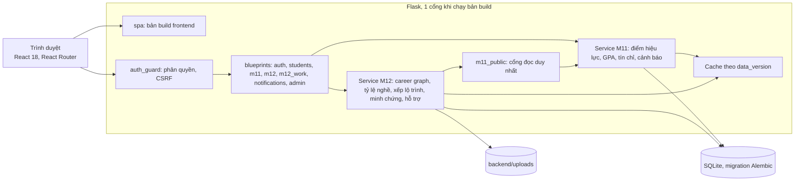
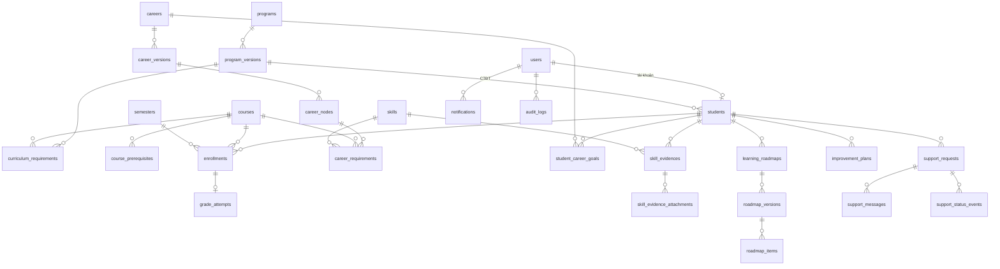

# Tư liệu kỹ thuật cho báo cáo

Tài liệu này là nguyên liệu, không phải báo cáo. Số liệu kiểm thử lấy từ output thật của từng giai đoạn. Toàn bộ dữ liệu trong hệ thống là dữ liệu mẫu.

## 1. Kiến trúc



Các nguyên tắc chính:

- M12 chỉ đọc dữ liệu M11 qua `m11_public`. Có test quét mã nguồn giữ ranh giới này.
- Hàm tính toán là hàm thuần, không đọc DB: `roadmap_service.generate`, `completion_service.evaluate`.
- Mọi đổi dữ liệu học tập tăng `data_version` trong cùng transaction; cache khóa theo `data_version` nên không cần xóa tay.
- Mọi route phải khai báo `@require_roles` hoặc `@public_route`, có test chặn route thiếu khai báo. Xem `docs/ROUTES.md`.

## 2. ERD rút gọn



Toàn bộ 44 bảng ở `docs/DATA_MODEL.md`.

## 3. API theo nhóm

Mô tả đầy đủ và ví dụ thật ở `docs/API.md`, chính sách quyền của từng route ở `docs/ROUTES.md`.

| Nhóm | Tiền tố | Nội dung |
|------|---------|----------|
| Xác thực | `/api/auth` | Đăng nhập, đăng xuất, phiên, tài khoản demo |
| Hồ sơ | `/api/students` | Hồ sơ, sửa liên hệ |
| M11 | `/api/m11` | `overview`, `grades`, `gpa-trend`, `credits`, `curriculum-check`, `strengths`, `compare`, `risks`, `semesters`, `metrics-glossary` |
| M12 nghề | `/api/m12` | `gallery`, `careers`, `related`, `my-careers`, `career-goal`, `progress/careers`, `requirements` |
| M12 lộ trình | `/api/m12/roadmaps` | Tạo, xem, sửa mục, phiên bản, đề xuất, áp dụng, bỏ qua |
| M12 công việc | `/api/m12` | `evidences`, `evidence-reviews`, `support-categories`, `support-requests`, `improvement-plan` |
| Thông báo | `/api/notifications` | Danh sách, đọc, đọc tất cả |
| Cố vấn | `/api/advisor` | Danh sách sinh viên được phân công |
| Quản trị | `/api/admin` | Nhật ký, nhập điểm, nghề, phiên bản, nhóm năng lực, yêu cầu, kỹ năng, ánh xạ môn và kỹ năng |

## 4. Thuật toán

### 4.1. GPA và học lại

Mỗi học phần chỉ có 1 lần học hiệu lực, chọn theo `retake_policy` của quy chế:

- `best`: lấy lần có xếp hạng điểm cao nhất; hòa thì lấy kỳ mới hơn.
- `latest`: lấy kỳ mới nhất; cùng kỳ thì lấy xếp hạng cao hơn.
- Xếp hạng: đạt có điểm trên miễn, miễn trên trượt.

Công thức, với S là các lần học hiệu lực được tính GPA (bỏ môn miễn và môn không tính GPA):

```
GPA = Σ (điểm hệ 4 × tín chỉ) / Σ tín chỉ    (với mỗi môn trong S)
```

Tính bằng `Decimal`, chỉ làm tròn khi trả về: 2 chữ số, `ROUND_HALF_UP`. Mẫu số 0 trả `null`, không trả 0. GPA kỳ dùng các lần học của đúng kỳ; GPA tích lũy dùng lần hiệu lực tính đến kỳ tham chiếu. Ví dụ số liệu mẫu SV02: `best` 3,00, `latest` 2,88 (`test_tc03.py`).

### 4.2. Tỷ lệ nghề và độ phủ (Q92, D-228, D-238)

Tính riêng cho từng cặp sinh viên và nghề, trên bản published mới nhất, chỉ yêu cầu đã duyệt và áp dụng cho ngành của sinh viên:

```
% học phần     = số môn đã đạt / số môn của nghề có trong CTĐT ngành
% kỹ năng, dự án = số mục có minh chứng đã duyệt / số mục kỹ năng và dự án
độ phủ         = x / y
  x = số mã môn riêng biệt của nghề trong CTĐT ngành
  y = x + số dòng cẩm nang mà ngành không có
```

Phần trăm là số nguyên, làm tròn half-up từ phân số chính xác: `(2 × 100 × tử + mẫu) // (2 × mẫu)`. Mẫu số 0 trả `null`. Môn ngoài ngành hiện nhãn và không vào mẫu số. Môn đang học không được tính (TC07). Phần trăm chỉ đo mức đáp ứng yêu cầu đã khai báo, không phải xác suất được tuyển.

### 4.3. Xếp hạng nghề liên quan (R10, Q19)

Là gợi ý, không phải nghề cấp dưới. Có 2 cách xếp riêng, không gộp thành một điểm:

```
closeness(A, B)  = |R(A) ∩ R(B)| / |R(A) ∪ R(B)|    (Jaccard)
profile_fit(B)   = % học phần của sinh viên ở nghề B
```

R là tập môn và kỹ năng đã duyệt của bản published mới nhất, theo ngành. Xếp giảm dần, `null` xuống cuối, hòa thì theo tên.

### 4.4. Xếp lộ trình theo học kỳ (Q23, R11)

`roadmap_service` là hàm thuần và tất định.

Ràng buộc cứng, không bao giờ nới; không xếp được thì môn vào danh sách `unplaced` kèm lý do:

| Mã | Nội dung |
|----|----------|
| `NOT_IN_PROGRAM` | Môn phải thuộc CTĐT |
| `ALREADY_TAKEN` | Không xếp môn đã đạt hoặc đang học |
| `PREREQUISITE` | Không xếp trước tiên quyết |
| `OFFERING_CLOSED` | Không xếp vào kỳ đã biết là không mở lớp |
| `THESIS_LAST_SEMESTER` | Khóa luận ở kỳ cuối của lộ trình |
| `ABOVE_MAX_CREDITS`, `BELOW_MIN_CREDITS` | Giữ trong trần và sàn tín chỉ của quy chế |

Mục tiêu mềm theo thứ tự ưu tiên: đúng học kỳ của CTĐT, môn nghề chính, thứ tự khuyến nghị, môn dùng cho nhiều nghề, cân bằng tín chỉ.

Cách làm: chọn tập môn (gồm chọn môn tự chọn theo ưu tiên) rồi sắp xếp topo, tính cửa sổ kỳ cho từng môn, tìm kiếm có giới hạn 20.000 bước. Môn chưa có dữ liệu mở lớp được ghi "dự kiến" (TC12). Khi dữ liệu đổi, hệ thống tính đề xuất lúc đọc, cho xem khác biệt và chỉ ghi đè khi sinh viên xác nhận.

Giới hạn đã biết (D-261): đối chứng vét cạn trên 3.000 bài toán nhỏ, trong đó 1.104 bài có cách xếp, cho 9/1.104 ca bị báo không khả thi sai và 0 ca báo khả thi sai. Nguyên nhân là chọn môn tự chọn theo ưu tiên, không thử mọi tổ hợp.

## 5. Số liệu kiểm thử

### 5.1. Tổng hợp cuối

{{TONG_HOP}}

### 5.2. Theo giai đoạn

| Giai đoạn | pytest | Vitest | Cố ý làm hỏng |
|-----------|--------|--------|---------------|
| 05 | 1166 (coverage 100%) | 271 | 77 chỗ; lượt đầu lọt 7, 1 chỗ bỏ qua; sau xử lý bắt 77/77 |
| 06 | 1166 | 435 | 159 chỗ; bắt 158, lọt 1 (không đổi hành vi) |
| 07 | 1693 | 455 | 30 chỗ; sau xử lý bắt 29, lọt 1 |
| 08 | 1873 | 503 | 30 chỗ; lượt đầu bắt 27, sau xử lý bắt 30 |
| CR-03 | 1955 | 532 | 30 chỗ; lượt đầu bắt 27, sau xử lý bắt 30 |
| 09 | 2082 | 570 | 30 chỗ; lượt đầu bắt 29, sau xử lý bắt 30 |
| 10 | 2224 | 632 | 30 chỗ: bắt 29, 1 chỗ tương đương; phần sửa sau nghiệm thu thêm 14 chỗ, bắt 14 |
| Cuối | {{CUOI_PYTEST}} | {{CUOI_VITEST}} | {{CUOI_MUT}} |

Ở các giai đoạn 07, 08, CR-03, 09, sau khi thêm test tôi chỉ chạy lại đúng những chỗ đã lọt, không chạy lại toàn bộ.

### 5.3. Đối chứng và số kỳ vọng

| Nội dung | Kết quả |
|----------|---------|
| Số kỳ vọng tính tay `expected_results.json` | 235/235 mục (191 M11, 44 M12) |
| Đối chứng M11 với bản tham chiếu | 400 biến thể, không lệch |
| Đối chứng vét cạn thuật toán lộ trình | 3.000 bài toán, 9/1.104 ca báo không khả thi sai, 0 ca báo khả thi sai |
| TC11, ràng buộc cứng | 50 lộ trình ngẫu nhiên không vi phạm |

### 5.4. E2E và tiếp cận

{{E2E}}

### 5.5. Hiệu năng

Máy dev Apple M5, SQLite, gunicorn 1 worker, gọi tuần tự, nên số này **không phản ánh tải đồng thời**. CSDL ×20 của profile demo-k68: 160 sinh viên. Chạy lại bằng `python -m scripts.perf_p95`.

{{P95}}

## 6. Ảnh chụp

Ở `docs/screenshots/final/`, mỗi màn hình có 2 bản 1440 và 375. Profile demo-k68, riêng cảnh báo và kế hoạch cải thiện dùng `sv04` của profile test.

{{ANH}}

## 7. Nguồn dữ liệu

| Dữ liệu | Nguồn | Ghi chú |
|---------|-------|---------|
| Profile test | `docs/DATA_MOCK.md`, số tính tay | Dữ liệu mẫu tự dựng; ngưỡng quy chế là giá trị mẫu, cần đối chiếu quy chế NEU |
| CTĐT K68 | `docs/spec/ctdt-k68-2026.md` | Do nhóm tổng hợp, không phải dữ liệu chính thức |
| Cẩm nang 10 nghề | `docs/spec/lo-trinh-10-nghe-k68.md` | Do nhóm tổng hợp |
| Giả định | `docs/DATA_K68.md` | Tín chỉ: khóa luận 10, còn lại 3. Tiên quyết chỉ dựng từ thứ tự khuyến nghị, không phải tiên quyết chính thức |
| Màu và họa tiết | `docs/brand/reference/` | Họa tiết là SVG hình học nhóm tự vẽ |
